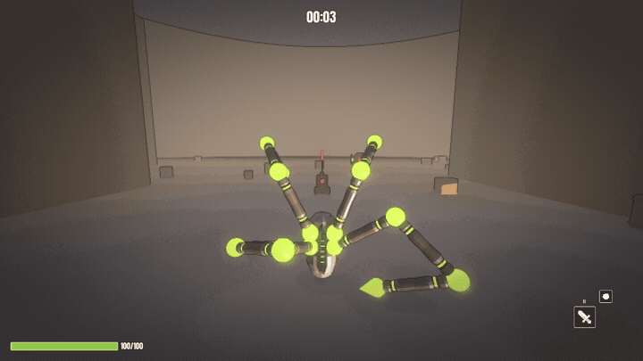
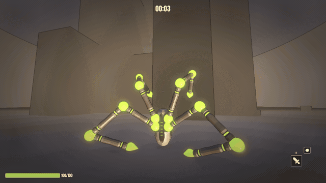
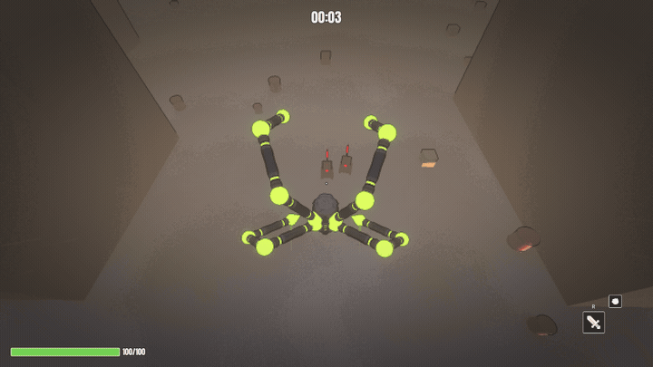
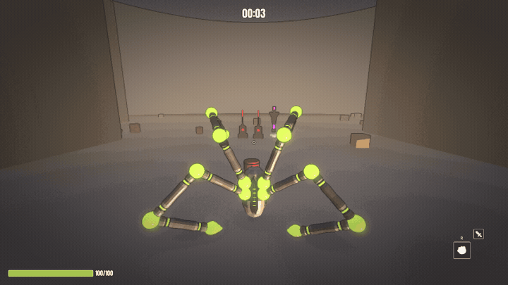
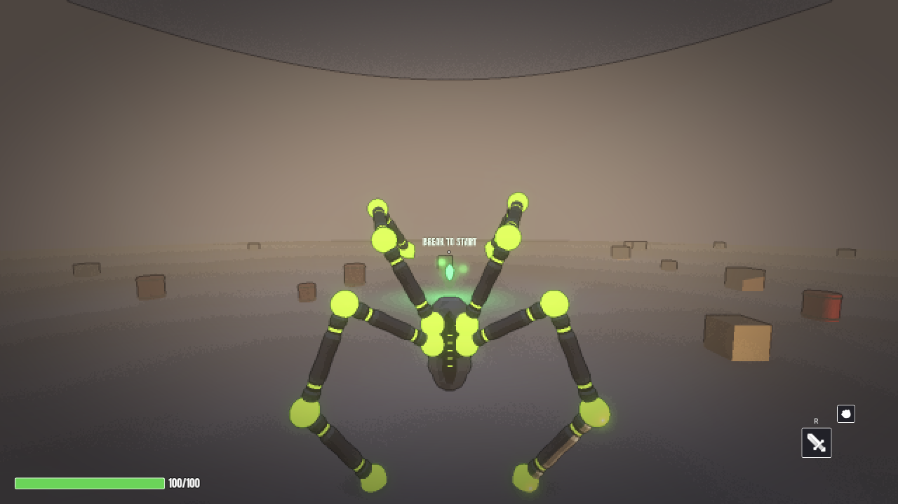
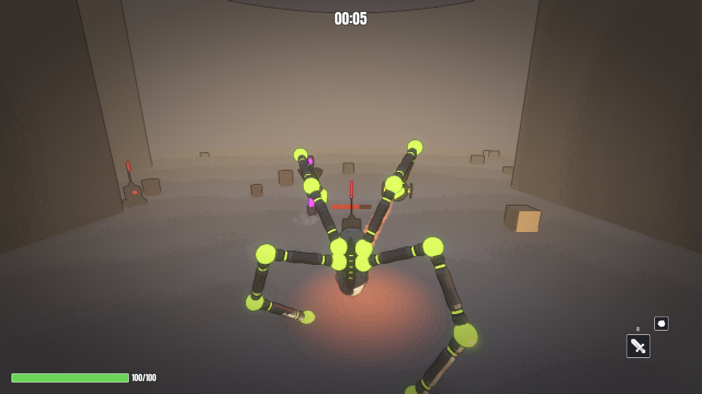
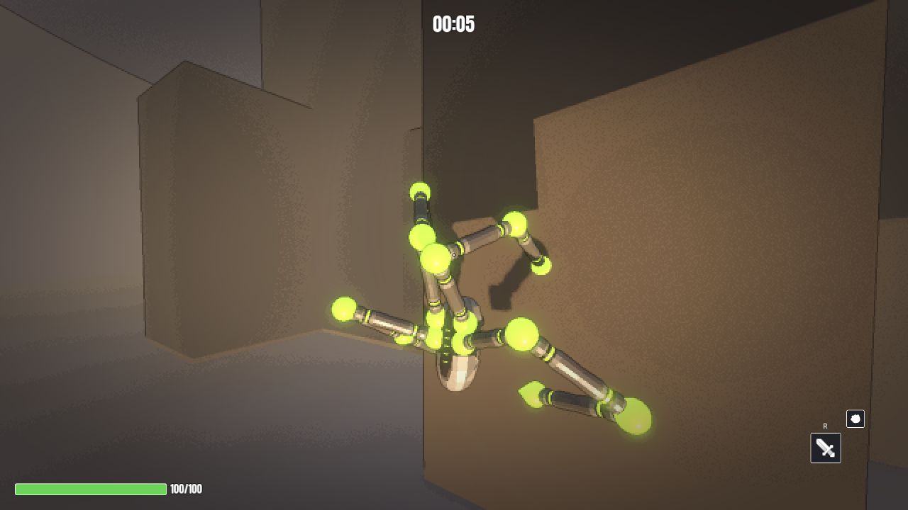
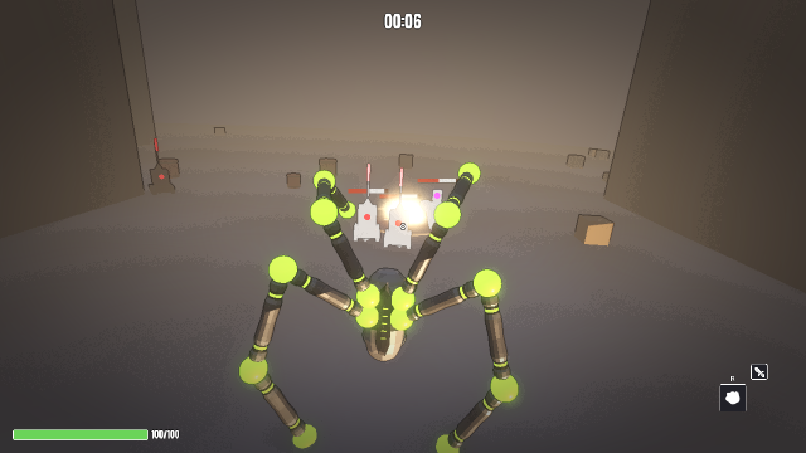

# doc-oc

A 3D wave-survival arena game inspired by Doctor Octopus, built in **Godot 4.7** with procedural four-limb inverse kinematics, vertical wall climbing, melee combat, and physics-based grabbing and throwing.

Pre-built binaries for Linux and Windows are available on the [Releases page](https://github.com/lliamsymonds04/doc-oc/releases/latest).

<p align="center">
  
</p>

## Devlogs

Follow the development of the project across the two YouTube devlogs:

| Devlog 1: Creating Doctor Octopus in Godot | Devlog 2: Adding attacks to my doc oc inspired game |
| :---: | :---: |
| [](https://www.youtube.com/watch?v=_os84fIzrdc) | [](https://www.youtube.com/watch?v=d5aGcz1MTbU) |
| [Watch on YouTube](https://www.youtube.com/watch?v=_os84fIzrdc) | [Watch on YouTube](https://www.youtube.com/watch?v=d5aGcz1MTbU) |

## Gameplay Showcase

### Wall Climbing

Run into any pillar to climb vertically with all four procedural limbs and wall-jump off into open air.

<p align="center">
  
</p>

### Ground Slam

While airborne, aim downward and press `Space` to dive-slam into enemies with an area-of-effect shockwave.

<p align="center">
  
</p>

### Grab, Throw & Explosive Barrels

Switch to Grab mode (`R`) to snatch crates, explosive barrels, or ragdolled enemies with either arm, drag or push/pull them in space, and flick upward on release to hurl them with crosshair homing.

<p align="center">
  
</p>

### Screenshots

| Opening Arena | Combat |
| :---: | :---: |
|  |  |
| **Vertical Wall Climbing** | **Explosive Barrel Detonation** |
|  |  |

## Features

- **Procedural Four-Limb IK (`LimbSolver`)** — Closed-form three-bone planar IK with joint angle limits, floor clearance, and inward elbow constraints. Two legs carry the body while two arms stay ready for combat, or all four limbs engage together during sprinting and wall climbing.
- **High-Mobility Traversal** — Adjustable hover height, all-four-limb sprinting, seamless vertical wall climbing and wall jumping, dash-tackling into enemies, charged high jumps, and aimed ground slams.
- **Dual-Mode Combat** — Toggle between **Attack** and **Grab** modes on the fly:
  - *Attack Mode*: Alternating punch combo with a heavy two-arm third hit, aim/focus camera, impact sparks, and crack decals.
  - *Grab Mode*: Independent left/right arm physics holds, mouse dragging, scroll-wheel push/pull, and flick-up throwing with ballistic homing toward the crosshair.
- **Procedural Arena & Escalating Waves** — Break the floating crystal to raise 34 noise-clustered pillars out of the floor and start the endless run timer. Runtime `NavigationMesh` rebaking adapts to risen pillars and moved crates/barrels.
- **Three Enemy Archetypes** — **Axe Bots** (Wave 1+ melee rushers), **Slam Bots** (Wave 2+ hopping robots that leap and dive-slam), and **Flying Orbs** (Wave 4+ hovering fireball drones).
- **Arena Hazards & Healing** — Physics crates, detonatable explosive barrels, and periodic healing gems that spawn atop risen pillars.
- **Stylized Look & Game Feel** — Dithered quantization and split-toning post-process shader, screen outlines, radial speed lines, directional damage indicators, dynamic FOV/camera trauma feedback, and an in-game pause menu with saved audio and sensitivity settings.

## Controls

### Movement

| Input | Action |
| :--- | :--- |
| `W` `A` `S` `D` | Move |
| `Shift` | Sprint (all four limbs) |
| `Q` / `Ctrl` | Raise / lower hover height |
| `Space` (Tap) | Dash (ram enemies to tackle) |
| `Space` (Hold) | Charged high jump |
| `Space` (Air, aim down) | Ground slam |
| `Space` (On wall) | Wall jump (move into pillars to climb) |
| `Esc` | Pause / settings / controls |

### Combat & Grabbing

| Mode | Input | Action |
| :--- | :--- | :--- |
| Both | `R` | Switch between Attack and Grab mode |
| Attack | `LMB` (Tap / Hold) | Punch combo (3rd hit = heavy two-arm strike) |
| Attack | `RMB` (Hold) | Focus / aim camera |
| Grab | `LMB` / `RMB` (Hold) | Grab with left / right arm |
| Grab | `Mouse Move` | Drag held object |
| Grab | `Scroll Wheel` | Push / pull held object |
| Grab | `Flick Up` + Release | Throw (homes toward crosshair) |

## Download & Play

Grab the latest pre-built release from the [GitHub Releases page](https://github.com/lliamsymonds04/doc-oc/releases/latest) (latest: [v0.1](https://github.com/lliamsymonds04/doc-oc/releases/tag/v0.1)):

- **Linux (`x86_64`)** — Download `doc-oc-v0.1-linux-x86_64.zip`, extract, and run `./doc-oc.x86_64`.
- **Windows (`x86_64`)** — Download `doc-oc-v0.1-windows-x86_64.zip`, extract, and run `doc-oc.exe`.

## Running from Source

### Requirements

- **Godot 4.7** (Forward Plus renderer, Jolt Physics — configured in `project.godot`)

### Steps

1. Clone the repository:
   ```bash
   git clone https://github.com/lliamsymonds04/doc-oc.git
   cd doc-oc
   ```
2. Open `project.godot` in Godot 4.7 and press **F5** (or run directly from the terminal):
   ```bash
   godot --path .
   ```

## Project Structure

```text
├── main.tscn / main.gd             # Main arena scene, level build, runtime navmesh rebaking
├── systems/
│   ├── inverse_kinematics/         # Closed-form 3-bone planar IK solver & arm mounts
│   ├── player/                     # Player state machine, attack, grab/throw, tackle, camera
│   ├── enemy/                      # Axe Bot, Slam Bot, Flying Orb, AI movement & attacks
│   ├── gem/                        # Start crystal & pillar-top healing gem spawner
│   ├── common/                     # Shared health controller
│   └── util/                       # Impact sensors, trails, damage flash, persistent settings
├── shaders/                        # Pixelation/dithering, outlines, speed lines, VFX shaders
├── ui/                             # HUD, crosshair, damage indicators, pause & death screens
├── assets/                         # 3D models, audio, VFX scenes, textures, UI sprites
├── addons/                         # Brackeys' Particle Controls editor plugin
└── tests/                          # Unit tests (math, enemy config, health bar)
```

## Credits

- **Music** — Action Adventure tracks by Luis Zuno ([@ansimuz](https://ansimuz.itch.io/)) (`assets/audio/action_adventure/public-license.txt`).
- **Editor Plugin** — [Brackeys' Particle Controls](addons/brackeys_particle_controls/plugin.cfg).
- **Font** — Anton (`assets/Anton-Regular.ttf`).

## License

This project is licensed under the [PolyForm Noncommercial License 1.0.0](LICENSE) — free to view, run, modify, and share for noncommercial and personal use, with commercial use prohibited. Third-party assets listed in [Credits](#credits) remain under their respective licenses.

Required Notice: Copyright Lliam Symonds (https://github.com/lliamsymonds04/doc-oc)
